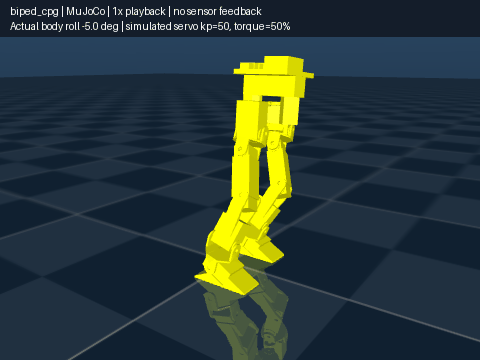

# biped_cpg: smaller-lean CPG walking

This is a **separate walking controller with hardware and simulation modes**. The quasi-static walker and all
other existing packages are unchanged. It uses the updated URDF and foot meshes,
with the same 12-joint position-command interface.

The controller uses **no IMU, force or contact feedback**. In hardware mode it
uses servo positions and bridge diagnostics to check readiness and tracking;
these checks pause or stop progression, rather than change the walking shape.
It still cannot measure body tilt or confirm that a foot is planted. Simulation
mode retains the original open-loop trajectory and uses simulation time.



## What is different from the quasi-static walker?

| Feature | Existing quasi-static walker | New CPG default |
|---|---:|---:|
| Planned body roll | 11.46° | **4.58°** |
| Lowering in single support | 40 mm | **28 mm** |
| Height change during a weight transfer | 20 mm | **8 mm** |
| Planned sole lift | 8 mm | **10 mm** |
| Calculated static support margin | about 18.5 mm | **about 10.49 mm** |
| Timing | Individual phases with settling holds | Continuous oscillator phase, without settling holds |
| Body movement during swing | Fore/aft weight target held over stance centre | Body advances from behind to ahead of stance centre |

The new plan has less sideways lean and less up/down movement. It also has less
room for balance errors. Smaller lean does not mean that all sideways body
movement disappears: weight still has to move toward the supporting leg.

This is deliberately slow walking, **not human walking speed**. At the default
joint limits the computed full cycle is about **20.48 s forward / 20.05 s backward**,
covering two steps. That is about 10 seconds per step. A smaller requested period
does not override the motion limits.

## Run separately after your hardware bringup

Use your existing robot launch **without `walk:=true`**. Walking is already off
by default there; this package does not start, stop or modify that launch:

```bash
ros2 launch biped_bringup hardware.launch.py
```

Rebuild the updated CPG once, from the workspace root, and source it in each
terminal you use:

```bash
cd /external_storage/manasa/biped
source /opt/ros/jazzy/setup.bash
colcon build --symlink-install --packages-select biped_cpg
source install/setup.bash
```

After your robot bringup finishes startup positioning, run the CPG separately:

```bash
ros2 run biped_cpg cpg_walk
```

It defaults to hardware mode (`use_sim_time=false`), using a monotonic computer
clock. **No MuJoCo environment, `/clock`, or IMU is needed.** It does not enable
servo torque, call motor services, or start walking automatically.

The existing node-only launch is also available:

```bash
ros2 launch biped_cpg cpg.launch.py
```

There is **no additional hardware launch file** in this package. To load a custom
configuration, use `config:=/absolute/path/cpg.yaml` with this existing launch.

Check feedback/status in another sourced terminal:

```bash
ros2 topic echo /cpg/status --once
ros2 topic pub --once /cpg_cmd std_msgs/msg/String "{data: 'step'}"
```

`step` approaches the known starting stance, takes one right-foot step, then
centres and holds. `start`/`forward`, `backward`, `stop`, and `hold` use the same
`/cpg_cmd` interface described below. Use support against a fall for the first
physical step; physical walking has not been validated by these software tests.

### What hardware mode checks

- `/joint_states` contains all 12 named, finite joint angles, inside URDF limits.
  Messages must have fresh source timestamps and arrive within 0.25 seconds.
  Joint velocity is read or estimated from consecutive position samples.
- The actual `servo_bridge` diagnostic reports torque ON, startup positioning
  finished, and no health warning/error. Diagnostic freshness limit: 2.5 seconds,
  allowing for the bridge's 1 Hz diagnostic output.
- Before starting, servos must be approximately stationary and within 0.05 rad
  (2.86°) of calibrated zero on the first run, or the last CPG held stance on a
  restart. Arbitrary folded-pose homing is refused.
- The first target captures the measured pose. A synchronized approach moves to
  the known stance at at most 0.10 rad/s, then checks settling before lowering
  into the existing walking trajectory. A restart recompiles the held stance
  before any new movement, then rechecks fresh feedback.
- Tracking error above 0.04 rad (2.29°) pauses **the whole path** until the motors
  catch up. Lag lasting over 2 seconds or error above 0.15 rad (8.59°) latches a
  fault and holds the last target. Joint angles are not independently clipped.
- Stale/invalid feedback, torque OFF, bridge health errors, startup repositioning,
  or another command publisher suppress further targets; the existing bridge
  retains its own watchdog/holding behaviour. Torque is never changed here.

`hardware_ready` in `/cpg/status` means feedback is fresh and the bridge is
healthy. Starting also checks stationary speed and proximity to the known pose.
`tracking_paused`, `max_tracking_error_rad`, `readiness`, and `fault` explain a
pause or refusal. Hardware thresholds are startup-only ROS parameters prefixed
with `hardware_`, for example `hardware_tracking_pause`.

A fault requires supporting the robot and restarting the CPG from a known stance;
there is no automatic reset or attempt to lower a raised foot after a fault.
`stop` during the small measured-pose startup approach holds there and latches a
fault. During the normal gait it finishes the step and centres as usual.
These are servo interlocks, not body-balance feedback or fall recovery.

## Build and run in MuJoCo

Use a Python environment where both ROS 2 and MuJoCo are importable. On this
machine the validation environment already exists:

```bash
source /opt/ros/jazzy/setup.bash
source /tmp/biped-gait-physics/bin/activate
```

That `/tmp` environment is temporary. For a persistent environment, the equivalent
setup is `/usr/bin/python3 -m venv --system-site-packages ~/.venvs/biped-cpg`, activate it,
and install `mujoco` there with `python -m pip install mujoco`. Source ROS first;
`--system-site-packages` lets that environment use the system ROS dependencies.
If MuJoCo already works in your active Python, no new environment is needed.

Build from the ROS workspace root and source the result:

```bash
cd /external_storage/manasa/biped
source /opt/ros/jazzy/setup.bash
colcon build --symlink-install --packages-up-to biped_cpg \
  --cmake-args -DPython3_EXECUTABLE=/usr/bin/python3
source install/setup.bash
ros2 launch biped_cpg mujoco.launch.py
```

The new launch starts the existing MuJoCo simulator, robot state publisher, and
CPG node. It uses `kp=50` and `torque_fraction=0.5`, the more compliant of the two
servo models tested here. The original walker is not started. The simulator is
reused through a small entry point in this package; no simulator code is changed.
The simulator uses the active `python3`, including an activated virtual environment.

Wait for the CPG node's **Ready** message. It compiles/checks both directions
before accepting movement. Launching alone sends no joint targets from the CPG.
The simulation starts in its normal zero-angle pose.

In another terminal, source ROS and `install/setup.bash`, then try one step:

```bash
ros2 topic pub --once /cpg_cmd std_msgs/msg/String "{data: 'step'}"
```

The body first lowers/centres over about 13.3 simulated seconds. It then takes
one right-foot step, centres again, and holds. For continuous walking:

```bash
ros2 topic pub --once /cpg_cmd std_msgs/msg/String "{data: 'start'}"
# Finish the current swing, put the foot down, and centre:
ros2 topic pub --once /cpg_cmd std_msgs/msg/String "{data: 'stop'}"
# After state becomes idle, try reverse:
ros2 topic pub --once /cpg_cmd std_msgs/msg/String "{data: 'backward'}"
```

`forward` is an alias for `start`. Change direction while idle. Repeated start
commands while moving are rejected. `hold` freezes the last joint target;
if a foot is raised, it stays raised. `stop` finishes a planned landing, so it
is not an immediate emergency stop.

Check state and the actual planned period:

```bash
ros2 topic echo /cpg/status --once
```

Useful launch options:

```bash
ros2 launch biped_cpg mujoco.launch.py headless:=true
ros2 launch biped_cpg mujoco.launch.py rviz:=true
ros2 launch biped_cpg mujoco.launch.py kp:=100.0 torque_fraction:=0.5
```

The CPG refuses to start alongside another publisher of
`/position_controller/commands`. If another writer appears while it is active,
it latches a fault and stops publishing. Run one walking node at a time.
If the simulator clock resets backwards, restart the CPG along with the reset
simulation. Do not reset the simulator underneath an active walker.

### Use an already running simulation

Leave that simulation's original walker disabled. Start only this controller:

```bash
ros2 launch biped_cpg cpg.launch.py sim:=true
```

For Gazebo the existing bringup command is
`ros2 launch biped_bringup sim.launch.py walk:=false`, followed by the CPG command
above. Gazebo has **not** been run for this package's validation; the reported
walking results below are from MuJoCo.

## How the CPG works, in simple terms

A phase is a number showing where we are in a repeating cycle. One complete
cycle goes from 0 to `2*pi` and covers two steps. The left and right phases are
kept `pi` apart: when one leg is in its swing part, the other is in support.

This is a pair of **coupled phase oscillators**, not a trained neural network
or a Hopf model. With `omega = 2*pi / period`:

```text
error = left_phase - right_phase - pi       (wrapped to -pi ... pi)
right_phase speed = omega + coupling * sin(error)
left_phase speed  = omega - coupling * sin(error)
```

The coupling brings a disturbed phase difference back toward `pi`. The code
integrates this particular pair exactly, avoiding numerical drift from a coarse
time step. It does not detect or correct physical body disturbances.

The right phase indexes a coordinated whole-body trajectory. The coupled left
phase stays opposite and influences the right phase through the coupling term.
Both legs use one consistent foot/body solution, rather than independently
adding sine waves to 12 joints. This preserves the planned foot contacts and
mass balance.

CPGs provide rhythm and coordination; they still need suitable movement shapes.
For background, see [Ijspeert's review of CPGs for robot locomotion](https://doi.org/10.1016/j.neunet.2008.03.014).

## What happens in each half-cycle?

1. **First 60%: weight transfer.** Both feet stay planted. The body moves toward
   the next supporting foot and changes its small lean. It rises by up to 8 mm
   near the middle of a transfer, then lowers for sideways reach.
2. **Last 40%: swing.** The other foot follows a smooth forward/backward arc and
   returns to the floor. The body keeps moving forward/backward during the swing.
3. The next half-cycle swaps the two legs immediately. There are no timed settling
   holds between lift, swing, and landing.

The first step is generated separately because the initial feet are alongside
each other. Once that step lands, it joins the repeating trajectory exactly.
Stopping uses a separate centred trajectory that leaves the feet where they landed.
Restart constructs a trajectory from that held stance.

For swing progress `t` from 0 to 1:

```text
smooth(t) = 10*t^3 - 15*t^4 + 6*t^5
foot X = old X + smooth(t) * (next X - old X)
foot Z = clearance * sin(pi*t)^2
```

The whole sole stays level and points forward. A forward landing is 20 mm ahead
of the other foot; after the first step, that foot travels 40 mm from its old
position to its new one. The reverse equivalents are 16 mm and 32 mm.

During a regular forward swing, the desired CoM moves from 10 mm behind the
supporting sole's centre to 10 mm ahead. There is 45 mm of sole length on either
side of its centre, so this leaves room fore/aft while reducing the stop/start
appearance of the body's forward travel.

## Where does balance come from?

The package reads the URDF-based model through the original gait's **pure math
helpers**. It never changes their constants and never instantiates that walker.

- Current mass: **1.2915 kg**.
- Zero-angle body height above the soles: **273.883 mm**.
- Body height near centred support: `273.883 - 20 = 253.883 mm`.
- Body height in single support: `273.883 - 28 = 245.883 mm`.
- Sideways weight target: supporting sole centre, moved **8 mm inward**.
- Narrower sole half-width: about **18.489 mm**.
- Remaining sideways static margin: `18.489 - 8 = 10.489 mm`.

At each planned sample, leg IK places both soles and keeps them level. The code
sums `mass * part position` for the body and both legs, including the raised leg,
then divides by the total mass. It adjusts body X/Y until that whole-robot CoM
matches the intended position. The chosen 4.58° body roll is a motion setting,
not an estimate from a sensor.

Full paths are checked before the command timer starts: joint limits, bent knees,
foot position/orientation, floor clearance, CoM tracking and static support
margin. The checks include interpolation between stored poses. Failed paths
prevent walking; joint angles are never individually clipped to hide a failure.

Cubic curves join the calculated poses with continuous joint velocity. Every
curve's peak speed and acceleration are calculated, including peaks between
rows. A period is lengthened to respect **0.35 rad/s** joint speed and
**0.6 rad/s²** acceleration. A delayed timer slows phase advancement; a clock gap
over 0.25 s latches a held-target fault instead of jumping along the trajectory.

Settings are in [config/cpg.yaml](config/cpg.yaml). They are compiled at startup;
changing them requires restarting the node. An alternate file can be supplied
with `config:=/absolute/path/cpg.yaml`.

## Verification

The hardware interlocks are tested with generated servo feedback only; no real
servo bus was opened. Tests cover source timestamp freshness, joint name ordering,
torque/startup/health gating, measured first targets, settling, tracking pause and
resume, persistent lag faults, stale feedback and suppressed output. An isolated
ROS test also exercises the standalone hardware node without `/clock`, including
a complete single step with a fake bridge and torque-OFF refusal/suppression.
These checks do not constitute a physical robot walking test.

**29 automated tests pass**, including four physics subcases. The checks cover
phase coupling, time-step independence, table seams, joint motion bounds, no
commands before start, one-step mode, stopping, reverse restarts, clock faults,
and suppressed output for a competing controller.

The ROS launch was also exercised headlessly with the actual simulator in an isolated ROS
domain: one step and stop, reverse restart through two landings, and suppression
when another command publisher appeared. Simulation mode has no IMU or joint-state subscriptions. Hardware mode
subscribes to joint states and diagnostics, never IMU data.

The physics runs use MuJoCo 3.17.0, the updated URDF, the existing simulator's
contact/friction/rotor-inertia defaults, a 50 Hz controller, and 50% of the
simulated servo stall-torque limit. Each run completes **nine landings**, centres,
and holds for three more simulated seconds. No disturbances are applied.

| Direction | Servo stiffness (N·m/rad) | Distance after stop | Peak body roll | Lowest measured swing-apex clearance |
|---|---:|---:|---:|---:|
| Forward | 50 | 0.160 m | 5.04° | 5.21 mm |
| Forward | 100 | 0.172 m | 4.81° | 7.45 mm |
| Backward | 50 | -0.115 m | 5.02° | 5.43 mm |
| Backward | 100 | -0.123 m | 4.80° | 7.57 mm |

The planned lift is 10 mm. Actual simulated clearance is lower because of
tracking error and body/foot deflection. An earlier 8 mm lift gave only about
3.2 mm clearance with the weaker servo model; that is why the default was raised.
Peak effort is about 0.87 N·m, and peak tracking error is below 0.018 rad.
These are results for the assumed simulation model, not measured ST3215 limits.

Additional extended checks at stiffness 50 completed **40 forward landings**
(0.717 m) and **40 backward landings** (-0.562 m), then stopped, without falling.
Peak roll remained 5.04°. Heading drift reached 2.55° forward and 1.17° backward;
there is no heading feedback to remove that drift.

Full numbers and assumptions are saved in
[validation/mujoco_results.json](validation/mujoco_results.json).
No fall occurred in those tests. This establishes the tested simulation cases;
it does not establish disturbance recovery, uneven-ground walking, or hardware
reliability. The URDF's mesh/CAD alignment caveat still applies. There is no
feedback-based fall detection or recovery in this controller.

Reproduce the checks without ROS nodes:

```bash
cd /external_storage/manasa/biped/src
PYTHONPATH=biped_cpg:biped_gait:$PYTHONPATH python3 -B -m biped_cpg.node --check
python3 -B -m unittest discover -s biped_cpg/test -v
```

The physics tests skip when MuJoCo/xacro are unavailable. To render the preview,
activate a ROS-compatible MuJoCo environment with Pillow and run:

```bash
MUJOCO_GL=egl python3 -B biped_cpg/validation/render_preview.py
```
