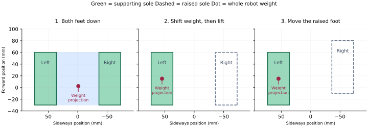

# How this quasi-static walker works

This node makes the robot shift its weight, lift one foot, move it, put it down,
and repeat. It uses the updated robot description to calculate the joint angles.
**It does not read an IMU, servo feedback, or foot-contact sensors.**

The main code is [quasi_static_walk.py](biped_gait/quasi_static_walk.py).
[robot_model.py](biped_gait/robot_model.py) reads the robot measurements from
[robot.urdf.xacro](../robotv2_description/urdf/robot.urdf.xacro) and its foot meshes.
Other packages and the URDF are not changed by this gait update.

This guide explains the numbers in the current code. Some numbers describe the
robot; others are deliberately slow, small motion choices. Keeping that
separation matters: a step length cannot be calculated from mass alone.

## 1. The basic idea: move the weight before lifting a foot

Think about standing on one foot. Your weight must be above that foot, rather
than above the gap between your feet.

We call the average position of all the robot's mass its **centre of mass**, or
**CoM**. Imagine a vertical line going down from that point to the floor.

- With two feet down, that line should land inside the area joining both soles.
- With one foot up, it should land inside the sole that is still down.
- Being just inside an edge leaves little room for errors. The new plan aims at
  the centre of the supporting sole while one foot is up.

“Quasi-static” means moving slowly enough that checking the weight position is
useful. Moving slowly reduces the extra forces caused by speeding up and slowing
down. It does not fix a weight position that is outside the supporting area.

The supporting area is called the **support polygon**: imagine stretching a
rubber band around the floor-contact corners. The static and moving cases are
explained in [MIT's notes on legged robots](https://underactuated.mit.edu/humanoids.html).
The checks here are model checks; they do not measure actual contact or balance.



## 2. Units and directions

The code uses metres, kilograms, seconds, and radians.

```text
1 metre = 1000 mm
1 kilogram = 1000 g
angle in degrees = angle in radians × 180 / pi
pi is about 3.14159

X = forward
Y = left
Z = up
```

For example, `0.020 m = 20 mm`, and `0.20 rad = 11.46 degrees`.
“Roll” means leaning sideways. With these axes, negative body roll leans left;
positive body roll leans right. These are planned angles, not IMU measurements.

## 3. What the updated URDF says

Each leg has six joints. Following the links from the body to the ground gives:

```text
body → hip yaw → hip roll → hip pitch → knee → ankle roll → ankle pitch → foot
```

Yaw turns around the up/down axis. Roll tilts sideways. Pitch tilts forward/back.
The physical chain has ankle **roll before pitch**. The command message lists
ankle **pitch before roll**. The code handles both orders explicitly.

### Mass and the centre of each separate part

The table uses grams and millimetres for readability. Each centre is measured
from **that part's own origin**, not from the floor or from the body.
These are the `<mass>` and `<inertial><origin>` entries of the current URDF.

| Part | Mass (g) | Centre X (mm) | Centre Y (mm) | Centre Z (mm) |
|---|---:|---:|---:|---:|
| Body/base | 325.1 | 0.766651 | -1.787673 | 33.975024 |
| Right upper hip | 86.5 | -0.111097 | -34.974486 | -12.755038 |
| Right lower hip | 22.2 | -18.643150 | -5.230758 | -5.418970 |
| Right thigh | 157.1 | 0.672256 | -25.691949 | -25.638526 |
| Right calf | 92.1 | 1.122282 | -23.608079 | -40.654266 |
| Right ankle | 22.8 | -16.743150 | -3.804758 | -4.582970 |
| Right foot | 102.5 | 19.198808 | -24.336599 | 0.423413 |
| Left upper hip | 86.5 | -0.679295 | 31.238295 | -12.755038 |
| Left lower hip | 22.2 | -19.243150 | 2.687242 | -5.418970 |
| Left thigh | 157.1 | 0.072106 | 24.055129 | -26.041769 |
| Left calf | 92.1 | 0.522282 | 21.649235 | -40.654266 |
| Left ankle | 22.8 | -17.343150 | 3.261242 | -4.582970 |
| Left foot | 102.5 | 18.705493 | 24.676201 | 0.608178 |

Add one leg:

```text
86.5 + 22.2 + 157.1 + 92.1 + 22.8 + 102.5 = 483.2 g

Whole robot = 325.1 + 483.2 + 483.2
            = 1291.5 g
            = 1.2915 kg

Weight on Earth = mass × gravity
                = 1.2915 × 9.81
                = 12.6696 newtons
```

The `imu_link` has zero mass in this URDF, so it adds nothing to that sum. The
IMU is not used for control. Its physical mass must already be included in the
URDF's other mass entries for this total to represent the real robot.

The left and right centres are slightly different. The code reads each side
separately instead of assuming they are exact mirror images.

The URDF also gives each part's **inertia**: how hard it is to speed up its
rotation. Inertia matters for moving-body forces. The static CoM calculation
uses mass and position, not inertia. The physics tests use the URDF inertias
through the existing simulator. This walker does not solve full moving-body
force equations or command motor torque.

### Distances between joint origins

These offsets are measured from the preceding part. They are unchanged in the
URDF update. Values below are in millimetres.

| Joint | Right X, Y, Z | Left X, Y, Z |
|---|---|---|
| Hip yaw | -1.590, -21.672, -0.150 | -1.590, +21.672, -0.150 |
| Hip roll | +19.100, -30.829, -40.776 | +19.100, +30.829, -40.776 |
| Hip pitch | -18.625, +20.625, -33.900 | -18.625, -20.625, -33.900 |
| Knee | 0, -2.000, -72.052 | 0, +2.000, -72.052 |
| Ankle roll | +18.625, -19.101, -72.184 | +18.625, +19.101, -72.184 |
| Ankle pitch | -18.625, +20.625, -33.900 | -18.625, -20.625, -33.900 |

Right hip yaw turns about `-Z`, while left hip yaw turns about `+Z`. Right hip
and ankle roll turn about `-X`; left ones turn about `+X`. Both hip pitches and
ankle pitches turn about `+Y`; both knees turn about `-Y`.

This is why equal physical motions do not always need equal signed commands.
The code uses the axes from the URDF when calculating each joint's effect.

### The floor-contact rectangle is read from the foot mesh

A mesh is a list of small triangles. The URDF tells us how to scale it and where
to put it relative to the foot joint:

```text
point in foot coordinates = mesh point × mesh scale + collision origin
```

Do this separately for X, Y, and Z. Using the STL numbers directly, or using
only the mesh scale, would give the wrong foot dimensions and standing height.

For example, the lowest foot-mesh Z is about `-284.535` in the STL's units.
The new right-foot Z scale is `0.000962561189483049`, and the collision origin Z
is `0.252962 m`:

```text
sole Z = -284.535 × 0.000962561189483049 + 0.252962
       = -0.020920675 m
       = -20.920675 mm relative to the foot-link origin
```

The code uses the bottom corners, not the bounds of parts higher up the foot.
For the current files:

| Quantity | Right foot | Left foot |
|---|---:|---:|
| Sole X interval in foot coordinates (mm) | -28.729181 to +61.270819 | -28.729181 to +61.270819 |
| Sole Y interval in foot coordinates (mm) | -40.738216 to -3.760237 | +3.855143 to +40.930303 |
| Length along X (mm) | 90.000000 | 90.000000 |
| Width along Y (mm) | 36.977978 | 37.075159 |
| Sole Z relative to foot origin (mm) | -20.920675 | -20.920675 |

The model reader currently requires flat rectangular soles, the present six-joint
chains, and the present joint-axis directions. It rejects unsupported changes
instead of quietly applying the wrong formulas. The current xacro has concrete
link/joint entries; moving them into xacro macros would require updating this
reader to expand those macros first.

## 4. Calculate the zero-angle standing height

At zero angles the joint origins can simply be added. Their downward Z distances
sum to:

```text
0.150 + 40.776 + 33.900 + 72.052 + 72.184 + 33.900
= 252.962 mm from the body origin to the foot-link origin

Standing height = 252.962 + 20.920675
                = 273.882675 mm
```

This is the height of `base_link` above the soles, not the height of the head.
The old script used a sole offset of `31.573 mm` and a zero height of
`284.535 mm`; those values no longer describe the current collision geometry.

At zero angles, the sole centres relative to the body are:

```text
right: X = 15.155819 mm, Y = -54.601227 mm
left:  X = 15.155819 mm, Y = +54.744723 mm

Sideways centre-to-centre spacing = 54.744723 - (-54.601227)
                                = 109.345950 mm
```

For example, right-foot X is the sum of joint X offsets, `-1.115 mm`, plus the
middle of the sole's X interval:

```text
-1.115 + (-28.729181 + 61.270819) / 2 = 15.155819 mm
```

When starting or restarting, the code uses the current held foot spacing. It
does not drag planted feet back to a predetermined stance width.

## 5. Calculate the whole robot's centre of mass

A heavy part counts more than a light part. For a simple example, put 1 kg at
X = 0 cm and 3 kg at X = 10 cm:

```text
average X = (1 × 0 + 3 × 10) / (1 + 3) = 7.5 cm
```

For the robot we do exactly the same calculation for all 13 massive parts:

```text
CoM X = sum of (each mass × that part's X position) / total mass
CoM Y = sum of (each mass × that part's Y position) / total mass
CoM Z = sum of (each mass × that part's Z position) / total mass
```

All positions must first be measured from the same origin. The local centres in
section 3 cannot be averaged directly.

At zero angles, add the joint offsets to each local centre. For example, the
right thigh's origin has Y = `-31.876 mm`, and its local mass centre has
Y = `-25.691949 mm`. Its mass centre relative to the body is therefore
`-57.567949 mm`. Its contribution to the sideways numerator is
`0.1571 × (-0.057567949)` in kg·m.

When a joint bends, rotate the parts below it before adding their positions.
For a turn around Y, one basic rotation rule is:

```text
new X = X × cos(angle) + Z × sin(angle)
new Z = -X × sin(angle) + Z × cos(angle)
```

The code applies the corresponding rule around each joint's own axis. A
rotation matrix is just a compact table for doing those three-coordinate sums.
This chain calculation is called **forward kinematics**: start with joint angles
and find where the parts end up.

For the current zero-angle pose the complete mass sum gives, relative to the body:

```text
CoM ≈ [2.503100, -1.065391, -93.9740] mm
```

Adding the body height puts that CoM about `179.9087 mm` above the floor. During
walking, both legs move and the body leans, so the code recalculates the sum at
every planned pose. The mass of the lifted leg still counts.

## 6. Choose reachable body positions and short steps

The old script used `0.178136 × sin(0.38) = 66.074 mm` of sideways body travel.
That fixed shift does not follow from the new mass distribution. The new node
solves body X and Y from the desired whole-robot CoM position instead.

An upright body cannot reach a sole-centred CoM throughout this gait without
exceeding a hip-roll limit or running out of leg reach. The new plan therefore
leans the body toward the supporting foot and lowers it for the sideways reach.
The feet themselves stay level and point forward.

| Code setting | Value | How it was obtained / why it is used |
|---|---:|---|
| `ZERO_HEIGHT` | 273.882675 mm | Sum of joint Z offsets and the mesh-derived sole offset |
| `CENTER_HEIGHT` | 253.882675 mm | Zero height minus a chosen 20 mm knee bend allowance |
| `CROUCH_DEPTH` | 40 mm | Chosen after checking reach and limits through both complete gait directions |
| `BODY_HEIGHT` | 233.882675 mm | Zero height minus `CROUCH_DEPTH`, used in single support |
| `BODY_ROLL` | 0.20 rad = 11.46° | Planned lean that makes both complete paths reachable with the lower stance |
| Forward `STEP_LENGTH` | 20 mm | Small initial landing distance ahead of the other foot |
| Backward `STEP_LENGTH` | 16 mm | Smaller distance in the reverse direction, which has different reach limits |
| `SWING_CLEARANCE` | 8 mm | Small whole-sole lift for a level floor; checked against reach and joint limits |
| `LIMIT_MARGIN` | 0.02 rad = 1.15° | Keep commanded joints inside the URDF limits |
| Minimum walking knee bend | 0.12 rad = 6.88° | Reject almost straight knees after the initial lowering |
| `MIN_SUPPORT_MARGIN` | 10 mm | Reject a planned weight projection too close to the supporting edge |

The last several entries are **motion choices**, not exact physical facts or
a mathematical guarantee that these are the best possible values. Candidate
stances with less lowering/lean failed reach or limit checks in parts of the
full path. The chosen pair passes startup, both gait directions, landings,
transfers, and stopping. Changing one number requires checking the whole path.

The body rises toward `CENTER_HEIGHT` in the middle of a transfer between feet.
That keeps the ankle pitch within its limits when both legs are under the body.
It lowers again as it moves toward the next supporting foot.

For a transfer from one full lean to the opposite full lean, with progress `s`
from 0 to 1:

```text
extra height = (CENTER_HEIGHT - BODY_HEIGHT) × 16 × s² × (1 - s)²
```

This is zero at the start/end and equals the 20 mm height difference halfway
through. Initial lowering and stopping use a smooth change between their
endpoint heights instead.

## 7. Solve the weight position and joint angles together

For each small part of a phase:

1. Set where both soles should be in a common floor-based coordinate system.
2. Set the desired body height and sideways lean.
3. Set the desired whole-robot CoM X and Y.
4. Guess the body X and Y and solve the leg angles for those foot positions.
5. Calculate the CoM from all the parts at those angles.
6. Compare that result with the desired CoM. Move the guessed body X/Y a little
   and solve again until the error is small.

When one foot is up, desired CoM X/Y equals the supporting sole's centre.
During a weight transfer it moves smoothly from one sole centre to the other.
When standing centred it lies halfway between the two sole centres.

An example from the initial left support, in floor-based coordinates:

```text
Desired CoM X/Y = left sole centre = [15.155819, 54.744723] mm
Planned body roll = -0.20 rad
Planned body height = 233.882675 mm

Solved body position ≈ [9.7893, 91.7320, 233.8827] mm
Calculated whole-robot CoM ≈ [15.1558, 54.7447, 154.3937] mm
```

The body origin is not the CoM. Shifting it by 54.7 mm would not automatically
put the whole robot's mass over the left sole. Also, as the right leg lifts and
swings, the body position changes slightly to keep the *total* mass centred.

**Inverse kinematics**, or IK, means finding joint angles that put a foot where
we want it. This node solves all six leg joints together, including foot angle.
It calculates how a tiny change in each joint moves/turns the foot. That small
response table is called a **Jacobian**. It uses that table to reduce the foot
position and angle errors, then repeats.

No infeasible joint angle is clipped to a limit. Clipping one joint alone would
spoil the coordinated foot position. A failed solve stops gait construction.
The knees stay on the bent-knee branch of the solution.

Because the body leans, a foot that is level in the room has the opposite tilt
when viewed from the body. The code accounts for this before solving the legs.
Hip yaw can be nonzero even though the foot points forward: it cancels the
combined turning effect of the other joints, including ankle roll then pitch.

## 8. Check how much room is left before tipping

For a rectangular supporting foot, measure the CoM projection's distance to all
four edges. The smallest distance is the **static support margin**.

At the centre of the right sole:

```text
distance to front/back edge = 90.000000 / 2 = 45.000000 mm
distance to sideways edge   = 36.977978 / 2 = 18.488989 mm

margin = smaller of those distances = 18.488989 mm
```

The left sole gives `37.075159 / 2 = 18.537580 mm`. Thus about **18.49 mm** is the
largest sideways margin available at the centre of the narrower sole.

The full-path checks give about **18.49 mm minimum** in either direction,
including transfers and interpolation between calculated poses. The node
requires at least 10 mm. It also checks that the single-support CoM is within
0.2 mm of the planned sole centre.

These very small calculation errors are software tolerances, not claims about
physical accuracy. Servo encoder steps, joint play, flexible parts and incorrect
mass/foot measurements can produce much larger errors on the real robot.

## 9. One walking cycle

| Phase | What moves | Where the weight target is |
|---|---|---|
| `ready` | Lower and centre the body; both feet stay planted | Halfway between soles |
| `lean_left` | Shift/lean body left and lower for sideways reach | Left sole centre |
| `lift_right_1st` / `lift_right` | Raise the right sole 8 mm | Left sole centre |
| `swing_right` | Move the raised right foot to its next X position | Left sole centre |
| `place_right` | Lower right foot vertically and wait | Left sole centre |
| `lean_right` | Move weight to the newly placed right foot | Right sole centre |
| `lift_left` | Raise the left sole 8 mm | Right sole centre |
| `swing_left` | Move the raised left foot to its next X position | Right sole centre |
| `place_left` | Lower left foot vertically and wait | Right sole centre |
| `lean_left_cycle` | Move weight to the newly placed left foot | Left sole centre |

“20 mm step length” means the newly landed foot is 20 mm ahead of the other
foot. After the first step, a foot moves about 40 mm from its old position to its
next position. The backward equivalents are 16 mm and 32 mm.

A planted foot keeps its floor position while the body moves. Two planted feet
keep their spacing. Landing changes the swing foot's height without sliding it
along the floor. Waiting after a landing is a timed pause, not contact detection.

`stop` finishes an airborne step, then centres and straightens the body to the
bent-knee standing stance. It holds the feet where they landed. Restart builds
new tables from that held stance. Change direction while stopped.

## 10. Move slowly, without sharp changes in joint speed

Each phase has a progress value `u` from 0 to 1. The planned foot/weight motion
uses:

```text
s = 10u³ - 15u⁴ + 6u⁵
```

For example, `u = 0` gives `s = 0`, `u = 0.5` gives `s = 0.5`, and `u = 1` gives
`s = 1`. This curve begins and ends with zero planned speed and acceleration.

The node calculates 81 joint poses per phase (`TABLE_SAMPLES = 80` intervals).
Between them it uses short cubic curves with continuous joint speed and zero
speed at phase endpoints. The checks use those same curves, including points
between the saved rows. They do not check only a few poses and assume the rest.

Timing has two parts:

- `SEGMENT_TIME × TIME_SCALE` gives a slow minimum duration. `TIME_SCALE = 1.5`.
- A phase is lengthened further if any joint would exceed `0.18 rad/s` or
  `0.30 rad/s²`. The maxima are calculated from the cubic curves, including
  peaks between table rows.

If a curve is spread over twice as much time, its speed halves and its
acceleration becomes one quarter. The duration calculation is:

```text
T = largest of:
    minimum phase duration
    peak joint speed for a 1-second phase / 0.18
    square root of (peak joint acceleration for a 1-second phase / 0.30)
```

`0.18 rad/s` is about `10.31 degrees/s`, below the existing hardware bridge's
`0.35 rad/s` soft-start speed. Commands publish at 50 Hz, once every 0.020 s.
At the maximum planned speed, a normal update changes an angle by no more than
`0.18 × 0.020 = 0.0036 rad`, about `0.206 degrees`.

Examples for a fresh forward start, excluding the following pause:

| Motion | Calculated time |
|---|---:|
| Initial lowering to `ready` | about 17.00 s |
| Initial left weight transfer | about 7.46 s |
| First right lift | 3.00 s |
| First right swing | 3.75 s |
| Right placement | 4.50 s |
| First rightward weight transfer | about 13.39 s |

This is deliberately slow walking. Ready holds for 1.2 s; weight-transfer holds
for 1.5 s; landings hold for 1.8 s, after applying `TIME_SCALE`. These are motion
settings, not values derived from robot mass.

## 11. What is checked before commands start

The node builds both forward and backward paths before starting its command
timer. It refuses failed paths. The checks include:

- CoM projection inside the intended supporting area, with at least 10 mm margin.
- CoM near the supporting sole's centre during lift, swing, and landing.
- Both soles level and pointing in the same forward direction.
- Planted soles on the same floor, and no swing-sole penetration.
- Fixed spacing between planted feet during transfers and stops.
- The intended 8 mm full lift, bent knees, and joint limits with the 0.02 rad buffer.
- Joint speed and acceleration limits for the actual interpolation curves.

The supporting leg is selected from the phase, not guessed from which foot is
lowest. Otherwise a foot going through the floor could hide a planner error.
The current numerical floor/spacing errors are below 0.001 mm in the rigid model.

## 12. Verification and its limits

The regression tests independently read the URDF and calculate part positions
and the CoM. They check the scaled STL contact corners, foot constraints, motion
limits, phase boundaries, stop/restart, direction changes, and rejected bad paths.
They also verify that future mass and mesh-scale edits are read automatically.

Optional MuJoCo tests use the **updated URDF**, the existing simulator, a 50 Hz
command rate, and `torque_fraction = 0.5`, matching the bridge's configured
500/1000 torque limit. At assumed stiffness 50 N·m/rad they complete six landings
forward and six backward, then stop with the body upright. Separate runs at
100 N·m/rad also completed six landings in each direction. No IMU or measured
joint positions are used to adjust any of these commands.

In the six-landing runs before stopping, the greatest torso tilt was about 12.1°,
including the deliberately planned 11.46° lean. Peak simulated motor effort was
about 0.84 N·m. These depend on the simulator's assumed servo, voltage, friction,
rotor inertia and ground contact; they are not hardware measurements or a
continuous-torque rating for ST3215 motors.

The description package's README currently says its inertials come from a CAD
mass model while its meshes were restored, and that articulated alignment has
not been validated. This walker uses the **current URDF and collision meshes**;
it cannot establish that those files match the actual assembled robot. In
particular, the 90 mm × roughly 37 mm contact soles and 273.883 mm zero-angle
base height above are model results to compare with the real robot.

No hardware walking test has been performed for this update. Without feedback,
this node cannot detect a late servo, slipping foot, early landing, or unexpected
body tilt, and it cannot recover from a fall. Correct dimensions and a valid
static plan improve the starting point; they do not guarantee physical walking.

## 13. Check, build and run

From the workspace source directory, run checks without starting ROS nodes or
connecting to the robot:

```bash
cd /external_storage/manasa/biped/src
python3 -B biped_gait/biped_gait/quasi_static_walk.py --check
python3 -B -m unittest discover -s biped_gait/test -v
```

The two physics tests skip if the optional `mujoco`/`xacro` Python modules are
unavailable. The other tests need NumPy and run without ROS. The model reader
prints which URDF it uses. A sourced installation takes priority over the source
fallback, so check that printed path when comparing results.

Build both the updated description and its gait dependency together:

```bash
cd /external_storage/manasa/biped
source /opt/ros/jazzy/setup.bash
colcon build --symlink-install --packages-up-to biped_gait
source install/setup.bash
```

Use the normal hardware bringup with its walker disabled, and leave the IMU out
of this experiment (`walk:=false imu:=false` on `biped_bringup hardware.launch.py`).
That launch currently defaults to enabling torque and moving to its startup
pose; have the robot supported and ready for that motion. Let startup finish.
Do not run `biped_balance` in actuator mode or another walker alongside this node.
The walking node initially publishes the zero-angle pose, so it expects the
robot to be in its calibrated zero/startup stance when first launched.

Run the walker in a sourced terminal:

```bash
ros2 launch biped_gait walk.launch.py
```

Then in another sourced terminal:

```bash
ros2 topic pub --once /walk_cmd std_msgs/msg/String "{data: 'start'}"
# To finish the airborne step, centre the body, and hold:
ros2 topic pub --once /walk_cmd std_msgs/msg/String "{data: 'stop'}"
# Once stopped, to walk the other way:
ros2 topic pub --once /walk_cmd std_msgs/msg/String "{data: 'backward'}"
```

Use support against a fall for the first hardware run. The first new things to
validate are this plan's lower stance and 11.46° weight-transfer lean, followed by
one lift and landing. Send `stop` during a lift/swing to finish that step and
centre. A stop sent before the first lift can return to centre without stepping.
`stop` is a planned finish, not an immediate emergency stop.

For simulation, use `ros2 launch biped_gait walk.launch.py sim:=true`.
The same joint order and `/position_controller/commands` topic are retained.
The old `docs/walking_math_explained.md` describes a previous version; this README
is the explanation of the current URDF-based planner.
